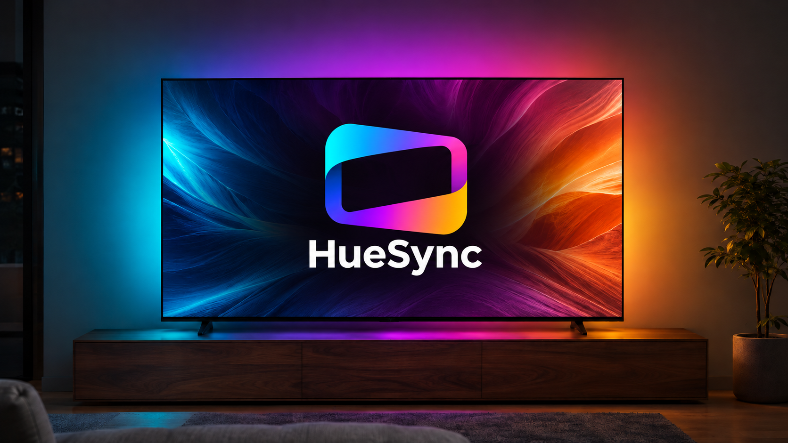
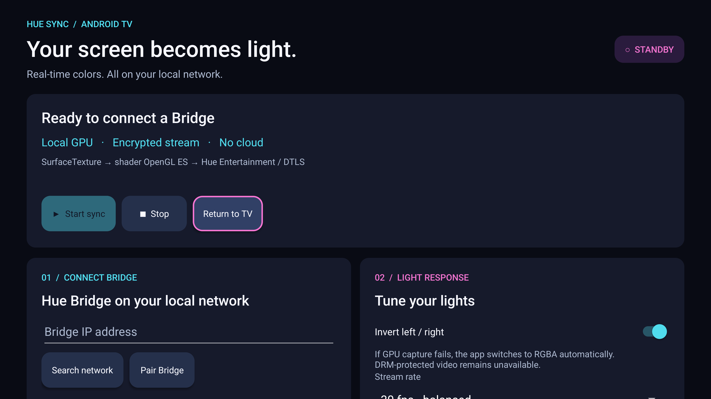

# HueSync for Android TV

[](https://github.com/snapps91/HueSync-Android-TV/actions/workflows/android.yml)
[](https://github.com/snapps91/HueSync-Android-TV/releases/latest)



HueSync is a native Android TV app that samples the TV's own screen and sends
per-light colors to a Philips Hue Entertainment area on the local network. It is
designed for ambient lighting while watching content on the TV where the app is
running.

The app does not record or transmit video. Screen capture is processed on the TV;
the Bridge receives only the RGB values for the Entertainment area's channels.



## Requirements

- An Android TV device running Android 6.0 (API 23) or later, with OpenGL ES 2.0.
- A Philips Hue Bridge with CLIP v2 and Entertainment support.
- An Entertainment area configured as a TV area in the Philips Hue app, with
  compatible color lights arranged around the screen.
- The TV and Bridge on a network where they can reach one another. HueSync uses
  HTTPS over TCP port 443 and Hue Entertainment DTLS over UDP port 2100.

HueSync targets Android TV. Support for screen capture, protected video, and
individual TV firmware varies by device and video app; see
[Limitations](#limitations).

## Getting started

1. Create a **TV Entertainment area** in the Philips Hue app and arrange its
   lights relative to the screen.
2. Install and open HueSync on the TV.
3. Discover the Bridge on the local network, or enter its local IPv4 address.
4. Press the physical link button on the Bridge and choose **Pair Bridge** in
   HueSync within the Bridge's pairing window.
5. Select the Entertainment area and adjust the sampling and response settings
   if needed.
6. Choose **Start synchronization** and approve Android's screen-capture prompt.
   HueSync runs as a foreground service while you return to the TV or open a
   video app. Stop the session in HueSync or from its notification.

The app includes a test pattern for checking the sampled screen regions against
the light positions. Settings are saved on the device and apply to the next
session.

## How it works

```text
Android MediaProjection
  → one VirtualDisplay at a reduced resolution
  → GPU path: SurfaceTexture / external OES texture
      → OpenGL ES shader samples each channel's screen region
      → N × 1 off-screen buffer; read back one RGBA pixel per channel
    or, if GPU setup/analysis fails or no first frame arrives within 8 seconds:
    ImageReader RGBA compatibility path using the same sampling kernel
  → color adjustment and time-based smoothing
  → HueStream 2.0 packet
  → DTLS 1.2 over UDP to the Bridge
```

### Capture and color sampling

When a session starts, Android displays its system consent prompt. HueSync creates
one `MediaProjection` session and one `VirtualDisplay` with the display's aspect
ratio. **Prioritize video playback** is enabled by default. It captures at 128
pixels wide (128 × 72 on a 16:9 TV) and samples 24 weighted points per channel.
Turning it off restores 384 pixels wide and 96 points per channel for higher
spatial detail. Lower resolution and fewer points can miss small colored details;
use the test pattern and actual content to choose the preferred tradeoff.

A `SurfaceTexture` receives display frames as an external OES texture. A fragment
shader averages each channel's region in linear light and renders one pixel per
channel to an N × 1 pbuffer. The CPU reads only those channel pixels, at most 80
bytes, rather than full TV frames.

With video priority enabled, HueSync first tries OpenGL ES 3 with asynchronous
pixel-buffer readback. Only one transfer can be in flight. Completion checks never
wait on a GPU fence and back off while the GPU is busy. The next acquisition
waits until the transfer completes. A transfer still incomplete after
500 ms triggers the RGBA fallback. If ES3 initialization is unavailable, the app
uses the OpenGL ES 2 synchronous path. Turning video priority off also uses ES2.
The renderer status identifies asynchronous or synchronous readback. Acquisition
and draw/readback diagnostics are wall times; asynchronous readback includes
completion polling delay and is not a GPU execution-time measurement.

During continuous video, the GPU sampler acquires the latest texture at each
analysis deadline without handling a notification for every producer frame.
When the texture stops changing it returns to waiting for a frame notification.
The lightweight shader uses precomputed sample offsets and weights. On drivers
that support GPU context priority, sampling requests low priority.

Video priority starts analysis at up to 20 fps, bounded by the selected stream
rate. Three consecutive samples costing over 10% of the sampling interval lower
the target in steps of 5 fps, down to 10 fps. Two seconds of inexpensive samples
with headroom at the next rate allow gradual recovery. This uses the sampler's
wall time, not the video player's FPS or total TV load. Without video priority,
analysis follows the selected stream cadence (20, 30, or 50 fps). These are targets;
actual rates depend on the device and content. Limiting analysis does not guarantee
that Android's compositor produces fewer capture frames.

Up to 20 channels are supported, including gradient segments reported by the
Bridge. Hue channel x and z coordinates map to horizontal and vertical screen
positions; room depth does not affect the projection. Horizontal inversion and
top/bottom crop can be adjusted.

If GPU initialization or analysis fails, or no first frame arrives within eight
seconds, HueSync switches once to an `ImageReader` RGBA analyzer. It reuses the
existing projection and VirtualDisplay, so only one capture path is active. The
fallback uses the same weighted sampling kernel and reads sampled locations from
the RGBA image without creating a bitmap. If the fallback cannot produce a frame,
the session stops with an error. A black frame by itself does not trigger a
fallback because it can be a genuinely dark scene or protected content.

For visible disturbances that do not report a capture error, choose **Try
compatibility capture** while synchronization is running. This switches once to
the same RGBA fallback, without creating another VirtualDisplay or requesting
capture consent again. It may use more CPU and is not a guaranteed fix for
firmware-related video tearing: Android still composes the captured screen.
Restart synchronization to return to the initial GPU path. This choice applies
only to the current session.

Sampling publishes complete, immutable linear RGB snapshots. The stream thread
adjusts saturation and brightness, converts for Hue output, and advances time-based
smoothing at the selected stream cadence, independently of new capture frames.
Light transitions therefore continue during sparse or static capture. This cannot
recover scene changes between samples. The available controls include video
priority, stream cadence, brightness, saturation, smoothing, vertical crop, and
horizontal inversion. The Bridge's channel positions and IDs are used
to associate each color with its light or gradient segment.

### Hue connection and streaming

Bridge discovery uses local mDNS (`_hue._tcp`). If discovery is unavailable or
does not cross the network, the Bridge can be entered by local IPv4 address.
Pairing uses the Bridge's physical link button and Hue's local API. The resulting
application key and DTLS client key are stored in app-private preferences,
encrypted with AES-GCM using a key held by Android Keystore. Android app backup is
disabled.

HueSync uses HTTPS with the bundled Hue certificate authorities and verifies
that the Bridge certificate identity matches the Bridge ID. It does not allow
cleartext HTTP or a permissive certificate fallback. The Hue Entertainment area
is started through the local CLIP v2 API; HueSync checks that its stream still
owns the area every three seconds and stops if ownership is lost.

Streaming runs on a separate network thread, so network operations do not block
frame analysis. It sends HueStream 2.0 packets using DTLS 1.2 with the
`TLS_PSK_WITH_AES_128_GCM_SHA256` cipher suite. Keepalive packets repeat the last
colors once the transition has settled on a static image. There is no frame backlog
or catch-up burst when the network is slow. When Android reports captured content as not visible, the
stream sends dimmed colors. On shutdown, HueSync releases the Entertainment area
if it is still the active owner.

## Privacy and security

- Android requires explicit consent for each screen-capture session. HueSync
  processes frames locally and does not save them or send them to the Bridge.
- Only per-channel color values are sent to the Bridge; a Hue cloud account is
  not required.
- Bridge HTTPS connections validate the Hue CA chain and Bridge identity.
- Pairing credentials are encrypted at rest with an Android Keystore key and
  app backup is disabled.
- The app does not bypass Android capture restrictions, DRM, or secure surfaces.

## Limitations

- DRM-protected content, `FLAG_SECURE` windows, hardware overlays, TV tuners, and
  HDMI inputs may appear black or may not be available to `MediaProjection`.
- HueSync captures only the display of the Android TV on which it runs. It cannot
  capture an HDMI source or another device over the network.
- Android requires user consent for screen capture. The foreground service can
  continue while the user switches apps, but capture does not automatically
  resume after reboot, consent revocation, or service termination. Closing the
  app from Recents ends the session.
- Only one controller can stream to an Entertainment area at a time. Stop other
  Hue Sync or third-party controllers before starting HueSync.
- Capture is SDR. HDR handling, protected-content behavior, and compatibility
  depend on the TV firmware and the video app.
- The current UI accepts local IPv4 addresses. If the Bridge address changes,
  discover it again or enter its new address.
- Video priority reduces capture detail and analysis work, but cannot guarantee
  smooth 4K playback: capture composition, hardware support, and resource
  contention depend on the TV firmware.
- The automatic RGBA fallback may use more CPU than the GPU path and remains
  subject to Android's capture restrictions.

## Build

Open the project in Android Studio with Android SDK 36.1 installed, or use the
Gradle wrapper from the repository root. The project uses JDK 21 for Gradle and
has a minimum device API level of 23.

```sh
./gradlew :app:assembleDebug
```

The debug APK is created at `app/build/outputs/apk/debug/app-debug.apk`. For
physical-device validation, install the app on the intended Android TV and test
with the actual Bridge, lights, and video apps; emulator behavior alone cannot
establish device compatibility.

The Android namespace and application ID are `com.snapps91.huesync`.

## Continuous integration and releases

The [Android workflow](.github/workflows/android.yml) runs on branch pushes, pull
requests, and version tags. It builds the debug APK, runs JVM unit tests, and
compiles Android instrumentation tests. Instrumentation tests still need an
Android device or emulator and are not executed by this workflow. The debug APK
is available as a workflow artifact.

Pushing a tag such as `v0.0.2` also builds a signed release APK and attaches it
to a GitHub Release, after the build and tests pass. The tag (with an optional
`v` prefix) must match `versionName` in `app/build.gradle.kts`. Update
`versionCode` for each release as well.

Before pushing the first release tag, add these repository Actions secrets under
**Settings → Secrets and variables → Actions**:

| Secret | Value |
| --- | --- |
| `HUESYNC_KEYSTORE_BASE64` | Base64 encoding of the release keystore file, without line breaks |
| `HUESYNC_KEYSTORE_PASSWORD` | Keystore password |
| `HUESYNC_KEY_ALIAS` | Signing key alias |
| `HUESYNC_KEY_PASSWORD` | Signing key password |

For the first secret, encode an existing keystore with
`base64 < /path/to/huesync-release.jks | tr -d '\n'` and paste the result as
the secret value.

Keep the keystore and passwords outside the repository and back them up securely.
Use the same signing key for subsequent APK updates. The workflow fails before
publishing if a signing secret is missing, the tag differs from the app version,
or Android cannot verify the APK signature.

## Project structure

- `MainActivity.kt` — Bridge setup, area selection, capture consent, and user
  actions; `MainScreen.kt` — native Android TV controls and status rendering.
- `SyncService.kt` — foreground session, Bridge ownership, DTLS scheduling, and
  status and stream-rate color smoothing; `CaptureCoordinator.kt` — the
  VirtualDisplay, immutable capture snapshots, and capture fallback.
- `GpuColorSampler.kt` — EGL/OpenGL ES external-texture shader pipeline;
  `GpuReadback.kt` — one asynchronous ES3 pixel transfer; `FrameCadence.kt` — fixed
  and adaptive analysis scheduling.
- `CompatibilityColorSampler.kt` — ImageReader RGBA fallback;
  `RgbaMacroSampler.kt` — its weighted spatial sampler.
- `HueApi.kt` and `BridgeDiscovery.kt` — local Bridge HTTPS API and mDNS
  discovery.
- `HueStream.kt` and `HuePacket.kt` — DTLS transport and HueStream packet format.
- `SyncModels.kt`, `ColorFilter.kt`, and `SyncSettings.kt` — channel mapping,
  options and status, color filtering, and encrypted credential persistence.
- `UserMessage.kt` — user-facing explanations of network and certificate errors.
- `PatternActivity.kt` — on-screen color and orientation test pattern.

## References

- [Android MediaProjection](https://developer.android.com/media/grow/media-projection)
- [Hue developer: getting started](https://developers.meethue.com/develop/get-started-2/)
- [Hue Entertainment](https://developers.meethue.com/develop/hue-entertainment/)
- [Hue HTTPS guidance](https://developers.meethue.com/develop/application-design-guidance/using-https/)
- [Bouncy Castle TLS documentation](https://www.bouncycastle.org/documentation/documentation-java/)
- Public Hue CAs are included from the
  [openHAB Hue CA bundle](https://github.com/openhab/openhab-addons/blob/main/bundles/org.openhab.binding.hue/src/main/resources/huebridge_cacert.pem).

## License

HueSync is available under the [MIT License](LICENSE).

The app uses Bouncy Castle TLS libraries under their applicable license. Third-
party license notices are included in the APK metadata. HueSync does not use the
legacy Philips Hue SDK, which was discontinued by Philips.
